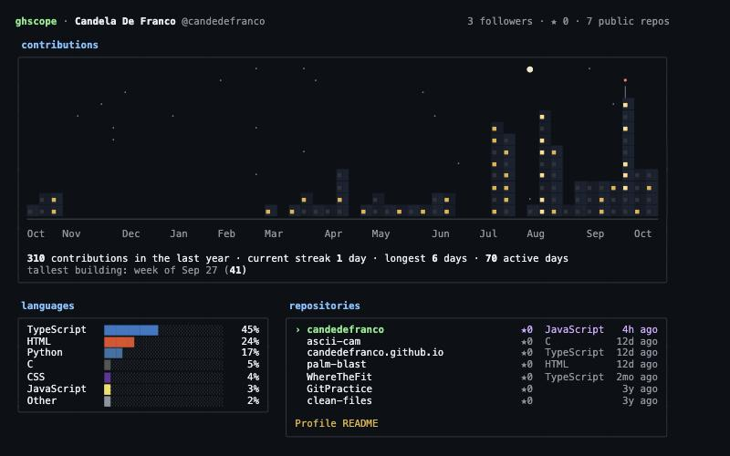
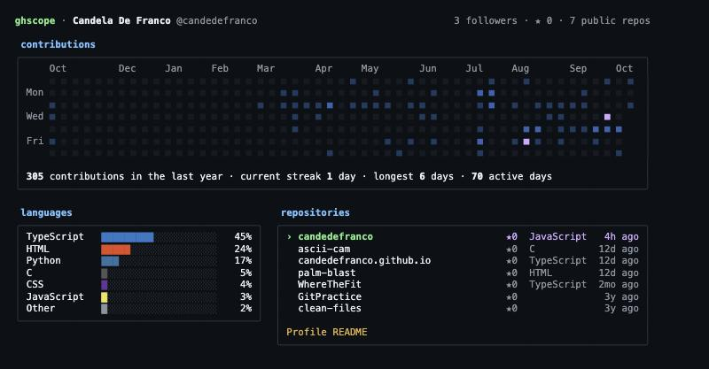

# ghscope

A GitHub dashboard for your terminal that draws your year of contributions as **a city at night**. Also shows streaks, top languages and recent repositories. Written in **Go** with [Bubble Tea](https://github.com/charmbracelet/bubbletea).



## The city

Every building is one week of your year:

- **Height** is how much you contributed that week.
- **Lit windows** are how many days that week you were active: a steady week glows, a one-day sprint is mostly dark.
- **Your best week** gets an antenna with a red light.
- Weeks with no contributions are empty lots.

When the dashboard opens, the windows switch on one by one, like a city at dusk.

### Night life

Every few seconds something happens over the city, picked at random (never the same twice in a row):

| | |
|:--|:--|
| 🦸 **Caped hero** | crouches, leaps off a rooftop and glides to another with its cape spread like wings |
| 🕸️ **Web swinger** | swings across the skyline from line to line |
| 🌠 **Shooting star** | streaks across the sky and burns out against the buildings |
| 🛸 **UFO** | crosses the sky and beams a building |
| 🎆 **Fireworks** | go off over your best week |

The hero and the swinger are pixel art: each character cell is split into two square pixels with half blocks (`▀` `▄`), which doubles the vertical resolution.

Press `a` to play one right away, or start with `--no-anim` for a still city. Press `v` for GitHub's classic grid:



## Install

Requires Go 1.26+.

```bash
go install github.com/candedefranco/ghscope@latest
```

## Usage

```bash
ghscope              # you (the account your token belongs to)
ghscope torvalds     # anyone else
ghscope --once       # print the dashboard once, no interactive UI
ghscope --view heatmap   # start on the classic grid instead of the city
ghscope --no-anim        # no random animations over the city
```

| Key | Action |
|:--:|:--|
| `↑` `↓` / `k` `j` | Move through repositories |
| `enter` / `o` | Open the selected repository in the browser |
| `p` | Open the profile in the browser |
| `v` | Switch between the city and the classic grid |
| `a` | Play a random animation now |
| `g` / `G` | First / last repository |
| `r` | Refresh |
| `q` | Quit |

### Token

The GitHub GraphQL API needs a token, even for public data. ghscope looks for one in this order:

1. `GITHUB_TOKEN`
2. `GH_TOKEN`
3. The [GitHub CLI](https://cli.github.com): `gh auth token` (just run `gh auth login` once)

A token with no extra scopes is enough.

### Privacy

ghscope only ever lists **public** repositories (`privacy: PUBLIC` in the query), even when your token can see private ones, so screenshots never leak private projects. Contribution counts are whatever GitHub shows on the profile.

## How it works

```text
main.go ─▶ internal/github ─▶ one GraphQL request: profile, contribution calendar, 100 public repos
              │
              ▼
           internal/stats ─▶ streaks, active days, stars, language shares (pure functions)
              │
              ▼
           internal/ui ─▶ skyline.go: the city (pure, deterministic)
                          events.go:  animations, each a pure function of its frame
                          sprite.go:  pixel art drawn with half blocks
                          canvas.go:  a grid of styled cells (and pixels) everything draws into
                          render.go:  heatmap, bars, panels (pure, width-aware)
                          model.go:   Bubble Tea model (loading, lights intro, scheduling, keys)
```

- **One request.** Everything comes from a single GraphQL query, so the dashboard loads in about a second.
- **Width-aware layout.** Two columns from 100 columns up, one column below. The heatmap keeps GitHub's spacing while at least 40 weeks fit, and drops the gaps to show more history on narrow terminals. A test checks that no line is ever wider than the terminal.
- **Height-aware too.** In a short terminal the dashboard gives up room in order of what's missed least: a few rows of the repository list (it scrolls), some floors of the city, the blank lines between panels. In a wide terminal everything stays on screen down to about 30 rows.
- **A stable city.** Which windows are lit, and the moment each one switches on during the intro, come from a hash of its position, so the same data always draws the same skyline.
- **Animations as pure functions.** Each animation picks its details once (which rooftops, where in the sky), then draws any frame from just the frame number. That makes every frame testable: tests check, for example, that the hero's arc clears a skyscraper without leaving the sky, and that nothing but the swinger draws inside a building (the hero's cape tucks in behind walls).
- **No runaway timers.** Animation ticks carry a generation number that changes whenever the view does, so stale timers are ignored instead of stacking up.
- **Pure rendering.** The drawing functions don't depend on Bubble Tea, so `--once` prints exactly what the interactive view shows, and the layout is unit-tested.

## Development

```bash
go test ./...
go vet ./...
go run . --once                         # colors are stripped when piped; CLICOLOR_FORCE=1 keeps them
```

## License

[MIT](LICENSE)
